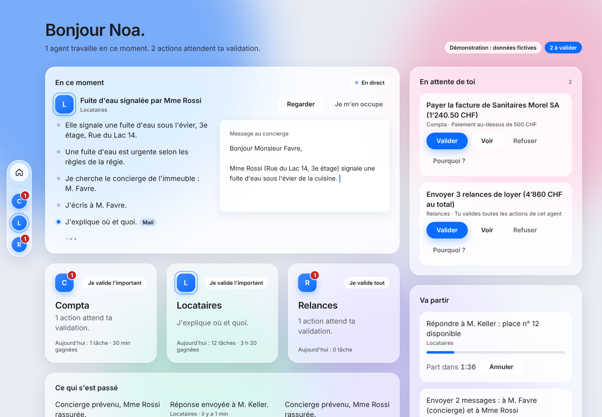
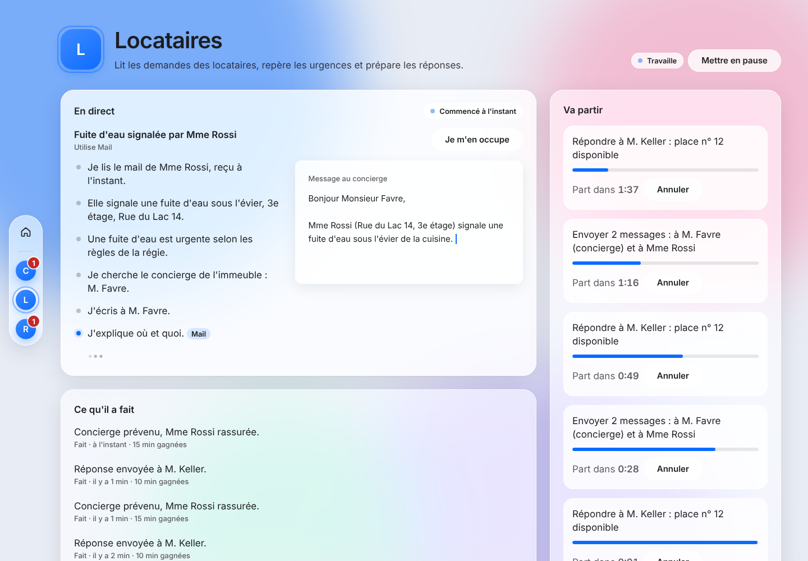
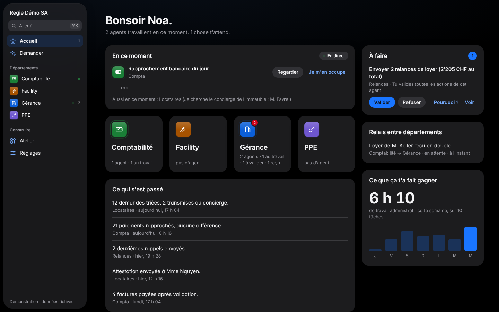
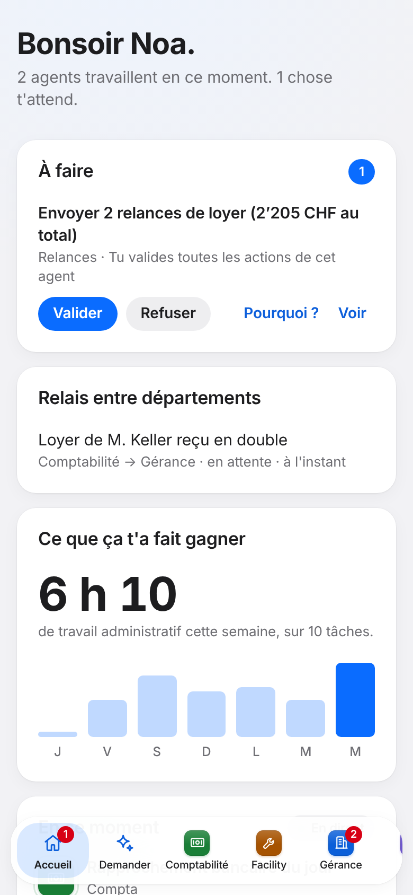
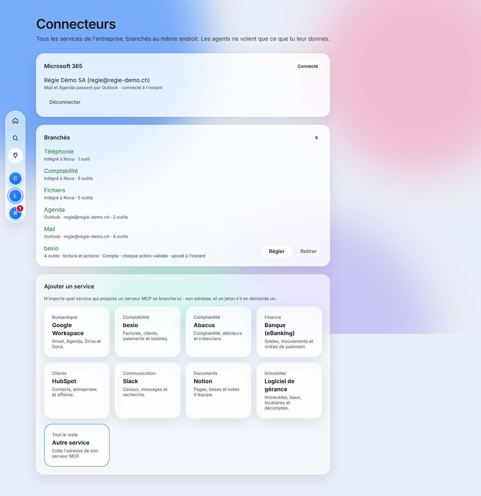
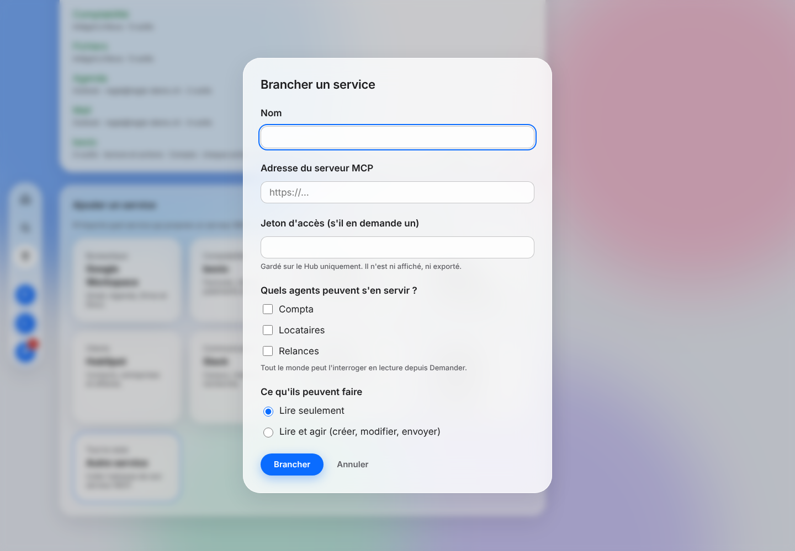

# Nova OS

Le système d'exploitation de l'entreprise. Il remplace Windows sur le poste : un bureau complet dont le dock **est** la boîte (Entreprise · apps · agents), des agents IA qu'on regarde travailler en direct, et une autonomie que le dirigeant choisit lui-même.

Une entreprise = un fichier `company.nix` + un dossier `data/`. Zéro lock-in.



| Un agent au travail, en direct | Mode sombre | Mobile |
|---|---|---|
|  |  |  |

## Les 4 couches

1. **Base** : NixOS immuable et déclaratif, disque chiffré, mises à jour atomiques.
2. **Bus d'API** : un serveur MCP par source (mail, calendrier, fichiers, compta, téléphonie…), et l'écran **Connecteurs** pour brancher n'importe quel autre service qui expose un serveur MCP.
3. **Agents** : Claude, encadrés par des règles d'autonomie appliquées hors de l'agent.
4. **Nova Desktop** : le bureau GNOME habillé par Nova (dock de la boîte, barre du haut, verre) et Nova Home (espace Entreprise, pages d'agents).

| Connecteurs : tous les services de la boîte au même endroit | Brancher un service |
|---|---|
|  |  |

## Démarrer

Prérequis : [Nix](https://nixos.org/download) (avec flakes) et Node.js 22.

```sh
npm install
scripts/dev            # Nova Home en démonstration → http://127.0.0.1:5173
```

| Opération | Commande |
|---|---|
| Tests unitaires (règles d'autonomie) | `npm test` |
| Interface de bout en bout + accessibilité | `npm run build && npm run test:ui` |
| Construire le système de l'entreprise de démo | `nix build .#nixosConfigurations.demo.config.system.build.toplevel` |
| Test de la VM complète (KVM nécessaire) | `nix build .#checks.x86_64-linux.vm-demo -L` |
| Image d'installation (clé USB, sans question) | `nix build .#installer-demo` |
| Vérifier une couleur d'accent | `node design/build.mjs check '#0A6CFF'` |
| Exporter toute l'entreprise | `sudo -u nova-gateway nova export` |
| Vérifier ou importer une archive | `nova verifier <archive> [--data <dossier>]` · `nova import <archive> --data <dossier>` |
| Connecter Microsoft 365 (une fois par éditeur) | voir [`docs/MICROSOFT-365.md`](docs/MICROSOFT-365.md) |
| Rapport du pilote | `scripts/rapport-pilote <data> <mise en service> <postes>` |
| Mesurer les questions (clé d'API) | `scripts/bench-question` |

## Le dépôt

```
flake.nix                    Point d'entrée : machines, paquets, image d'installation, tests
companies/demo/              Une entreprise : company.nix + data/ (formats ouverts)
modules/                     Modules NixOS nova.* : base, disque, hub (gardien, flotte, sauvegarde), poste (bureau)
packages/nova-server/        nova-gateway (Hub), nova-daemon (poste), connecteurs MCP, commande nova
packages/nova-home/          Interface : espace Entreprise, agents, Demander, connecteurs, coûts, flotte
packages/nova-shell/         Extension GNOME : la barre du haut Nova
packages/installer.nix       Image d'installation automatique
verticals/gerance/skills/    Le métier des agents de gérance, en Markdown
design/                      Tokens du système de design (source unique)
tests/                       Tests VM (poste, connecteurs réels, portabilité), test de l'interface
scripts/                     dev, bench-question, rapport-pilote
```

## Documents

| Document | Contenu |
|---|---|
| [`MISSION.md`](MISSION.md) | Le brief d'origine |
| [`ARCHITECTURE.md`](ARCHITECTURE.md) | Les 4 couches, l'autonomie, les agents visibles, le format `data/` |
| [`DESIGN-SYSTEM.md`](DESIGN-SYSTEM.md) | Tokens, matière verre, composants, règles d'écriture |
| [`ROADMAP.md`](ROADMAP.md) | Les phases du MVP et leurs métriques |
| [`DECISIONS.md`](DECISIONS.md) | Les choix tranchés et les questions ouvertes |
| [`EXPORT-SPEC.md`](EXPORT-SPEC.md) | Le format d'export : toute l'entreprise, lisible sans Nova |

## Statut

MVP construit, phases 0 à 3 (voir `ROADMAP.md`) : bureau Nova, bus MCP à 5 connecteurs (testés contre de vrais serveurs), agents Claude visibles avec autonomie choisie, questions en langage naturel, export et import sans perte, flotte du Hub, connecteurs ajoutés depuis l'interface (tout service MCP), Microsoft 365 en un clic (mail et agenda Outlook). Restent à faire : brancher une clé d'API Anthropic, installer le pilote et mesurer, et gérer des postes distants (Q-3).
